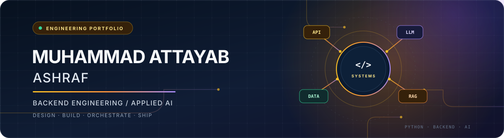

<!--
  Profile README for github.com/Attayab-31
  Create/update the public repository: Attayab-31/Attayab-31
  Keep project claims, metrics, and technology lists aligned with verifiable work.
  The hero banner is a local asset: commit assets/profile-hero.svg with this README.
-->

<p align="center">
  <!-- Keep this asset in the profile repository at assets/profile-hero.svg -->
  
</p>

<p align="center">
  <a href="https://github.com/DenverCoder1/readme-typing-svg" target="_blank">
    
  </a>
</p>

<p align="center">
  
  
</p>

<p align="center">
  <a href="https://www.linkedin.com/in/attayab-ashraf-519562262/">
    
  </a>
  <a href="mailto:attayabpc2@gmail.com">
    
  </a>
  <a href="https://github.com/Attayab-31">
    
  </a>
  
</p>

---

## About me

I'm a **Backend Engineer focused on Python systems and applied AI/LLM engineering**. I build backend services, data-processing workflows, and AI-powered applications that connect APIs, databases, background workers, and model providers into dependable products.

I currently work as a **Python Developer at DevVerx**, and also bring freelance experience delivering end-to-end client systems — from architecture and implementation to deployment and handover.

My engineering interests include:

- **Backend systems:** API design, service architecture, database-backed applications, integrations, and asynchronous processing.
- **Applied AI:** Retrieval-Augmented Generation (RAG), semantic search, embeddings, OCR-based document processing, and multi-agent workflows.
- **LLM applications:** Multi-provider orchestration, structured outputs, fallback handling, and AI-assisted automation.
- **Production engineering:** Dockerized deployments, database migrations, authentication, background jobs, testing, and operational reliability.

I enjoy working where **backend engineering meets practical AI** — turning complex workflows into maintainable software.

## Technical toolkit

### Backend & application engineering

<p>
  
</p>

<p>
  
  
  
</p>

### AI, LLM & data systems

<p>
  
  
  
  
</p>

<p>
  
  
  
  
  
</p>

### Databases, infrastructure & delivery

<p>
  
</p>

<p>
  
  
  
</p>

## Selected public projects

These projects represent the areas I most want to showcase: backend architecture, applied AI, retrieval systems, and developer tooling.

<table>
  <tr>
    <td width="50%" valign="top">
      <h3>🤖 <a href="https://github.com/Attayab-31/DocAgent-with-C-support-">DocAgent — C/C++ Support</a></h3>
      <p>Multi-agent documentation tooling for codebases. Extends documentation workflows with C/C++ AST-level analysis and specialized Reader, Searcher, Writer, and Verifier agents.</p>
      <p><sub>Python · libclang · AST Parsing · LLM APIs · Multi-Agent Systems</sub></p>
    </td>
    <td width="50%" valign="top">
      <h3>📚 <a href="https://github.com/Attayab-31/TextBook-RAG-Chemistry">TextBook RAG — Chemistry</a></h3>
      <p>Document question-answering work built around extraction, preprocessing, embeddings, semantic retrieval, and LLM response generation. The related CV project indexed 1,000+ OCR-extracted chunks.</p>
      <p><sub>Python · FAISS · Sentence Transformers · PyMuPDF · Tesseract · LLM APIs</sub></p>
    </td>
  </tr>
  <tr>
    <td width="50%" valign="top">
      <h3>🎬 <a href="https://github.com/Attayab-31/Aura-Flux">AuraFLUX Video Studio</a></h3>
      <p>AI-assisted script-to-video workflow covering scene planning, narration, image generation, asynchronous processing, and final video rendering.</p>
      <p><sub>Python · Flask · PostgreSQL · LLM APIs · FFmpeg · MoviePy</sub></p>
    </td>
    <td width="50%" valign="top">
      <h3>🧪 <a href="https://github.com/Attayab-31/Personality-Predictor-ChatBot">Personality Predictor Chatbot</a></h3>
      <p>A conversational personality-assessment application. See the repository for the current implementation, setup instructions, and project details.</p>
      <p><sub>Project implementation and dependencies: see repository</sub></p>
    </td>
  </tr>
</table>

### More projects & experiments

- [Pakistan Election Prediction 2024](https://github.com/Attayab-31/Pakistan-Election-Prediction-2024)
- [Aixploria Website Scrapper](https://github.com/Attayab-31/Aixploria-Website-Scrapper)
- [Ludo Titan Automation](https://github.com/Attayab-31/Ludo-Titan-Automation)
- [PrismHD](https://github.com/Attayab-31/PrismHD)

## Selected client engineering work

Some of my professional projects are proprietary. I can describe the engineering work and outcomes here without publishing client source code, credentials, or confidential implementation details.

| Project area | Engineering contribution |
|---|---|
| **ReconFY — financial reconciliation SaaS** | Built reconciliation workflows across PDF, Excel, and POS data using a Python/FastAPI and AWS-based microservices architecture. The project was reported to reduce manual reconciliation workload by approximately **80%**. |
| **AI Tenant Screener — voice AI** | Integrated telephony, speech-to-text, configurable LLM providers, text-to-speech, PostgreSQL, and Celery/Redis background workflows for automated applicant screening. |
| **ReadyRentalsOnline — property maintenance** | Built backend APIs and workflows for work orders, technician assignments, reports, authentication, role-based access, audit logging, and Docker-based VPS deployment. |
| **ETL & workflow automation** | Developed validation, deduplication, and scheduled processing pipelines. Client work was reported to reduce manual data-processing effort by approximately **90%**. |

<sub>Impact figures above are the results reported in my CV. They are not presented as independently audited benchmarks; detailed measurement context can be shared where permitted.</sub>

## Engineering approach

```text
Understand the problem
        ↓
Design the system and data flow
        ↓
Build APIs, integrations, and business logic
        ↓
Add validation, tests, and failure handling
        ↓
Containerize and deploy
        ↓
Document, monitor, and improve
```

I value:

- Clear service boundaries and maintainable code.
- Secure configuration and careful handling of secrets.
- Reliable background processing, retries, and failure recovery.
- Database migrations and explicit API contracts.
- Reproducible AI workflows and honest evaluation.
- Documentation that helps another engineer run and understand the system.

## GitHub activity

<p align="center">
  
  
</p>

<sub>Language statistics reflect code detected in repositories; they are not a measure of proficiency. Activity cards are provided by a third-party service and may occasionally be unavailable.</sub>

## Certifications

- [IBM — DevOps](https://www.coursera.org/account/accomplishments/verify/TIWZA609JI4T)
- [IBM — Python for AI](https://www.coursera.org/account/accomplishments/certificate/A4XJZ8RJQ43V)

## Let's connect

I'm based in **Lahore, Pakistan** and open to **Backend Engineer, AI Engineer, and LLM Engineer** opportunities, including remote and on-site roles.

<p align="center">
  <a href="https://www.linkedin.com/in/attayab-ashraf-519562262/">LinkedIn</a>
  &nbsp;•&nbsp;
  <a href="mailto:attayabpc2@gmail.com">Email</a>
  &nbsp;•&nbsp;
  <a href="https://github.com/Attayab-31">GitHub</a>
</p>

<p align="center">
  <i>Building dependable software systems and making AI useful in the real world.</i>
</p>
